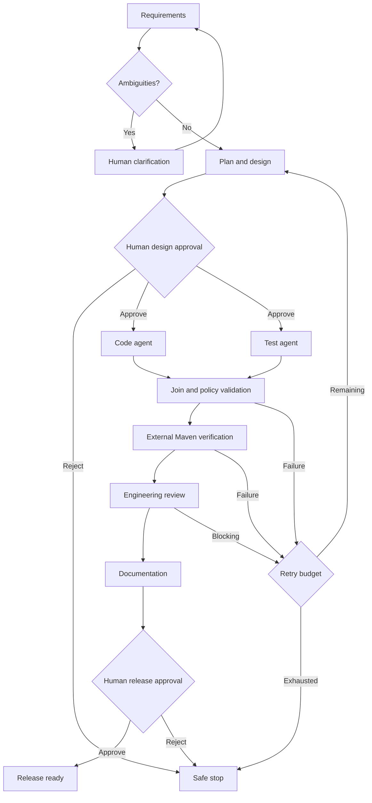

# Governed Agentic SDLC — URL Shortener
**Engineering assessment | Mahshid Azarpour | November 25, 2026**

## 1. Executive summary
This prototype converts software requirements into reviewable candidate changes using a stateful LangGraph workflow, live Claude assistance, explicit human approvals and external verification. The reference Java 21 / Spring Boot service implements URL creation, redirects, analytics, expiration, custom aliases, idempotency, Redis caching and rate limiting. PostgreSQL is the authoritative store.

Two live scenarios reached release readiness. The Brownfield run demonstrates a test-only enhancement adding five real Redis integration tests, followed by successful regression verification, engineering review, documentation and human release approval. Greenfield required human-assisted recovery after provider failures. The Ambiguous run completed clarification, corrected design, implementation, external verification, nonblocking review, documentation and human release approval. Release-ready denotes a reviewed candidate, not deployment to production.

## 2. Architecture

FastAPI provides the control plane; SQLite checkpoints preserve run state across interrupts and restarts. The dependency graph forks code and test generation and synchronizes before candidate validation. Agents share the approved design and file ownership contract. Provider outputs are schema validated and generated in bounded batches. Candidate files are isolated from the baseline; failed candidates are archived. Human approval hashes bind decisions to design or release artifacts. The service is deployed separately from the orchestration plane.

Service layers: UrlController handles HTTP contracts; UrlService coordinates business rules, transactions and idempotency; policy classes validate URLs, aliases and expiration; repositories access PostgreSQL; RedisCacheService and RateLimiter provide caching and rate control. Flyway manages schema versions. Redis failure favors availability through fail-open behavior, with PostgreSQL fallback for cached data.

## 3. API contract
| Method and route | Behavior |
|---|---|
| POST /api/v1/urls | Accepts url, optional alias and expiresAt; optional Idempotency-Key header; returns 201 with code and shortPath |
| GET /{code} | 302 redirect with Location and no-store; missing or expired links return 404 |
| GET /api/v1/urls/{code}/analytics | Link click analytics |
| GET /actuator/health | Service health |
| POST /runs | Start a scenario |
| POST /runs/{id}/resume | Supply clarification, approval or verification evidence |
| GET /runs/{id} | Inspect state and pending interrupts |
| GET /runs/{id}/audit | Inspect audit events |
| GET /metrics | Prometheus orchestration metrics |

## 4. Scenario evidence
### Greenfield — recovered and verified
The initial live run `6e80abea-f769-48e8-9633-92d3a5f7a4b1` encountered provider output/timeout failures and exhausted replanning. Partial batches were recovered and missing implementation/tests completed with human assistance. The recovered baseline passed 177 unit and 2 integration tests using PostgreSQL 16 and Redis 7. This is not an autonomous release-ready run. Retain the original failure and recovery evidence.

### Brownfield — release ready
Run `0dae8850-00ce-4106-8908-9ddfb7a30741`. Requirement: add real Redis rate limiter coverage without production changes. Design scoped the change to a new RateLimitRedisIT.java file. Live generation, external verification, nonblocking review, documentation and human release approval completed. Maven reported 177 unit and 7 integration tests, zero failures/errors/skips, exit 0, 38.233 seconds. Five new tests cover rejection, expiry/recovery and isolation using real Redis. Candidate hash: `c20b3d5260e102fed4f8a8997a45c204a752c35d196b26e76b1faa6fcc849971`. Verification log SHA-256: `8d6adb379c38051f4c93d30d67c307d52afd5f8d831c4dd356c31700fa704590`. The model reviewer did not independently inspect the log; the operator supplied verification evidence.

### Ambiguous — release ready
Original run `8d1b7e06-0e17-4e31-852c-4fb723fc2d60` identified three ambiguities but planned against the scaffold rather than the verified baseline. Human rejection resulted in safe_stop. Baseline selection and scenario policy were corrected; 13 Python tests passed afterward. Corrected run `94e9c2a1-7ac5-44f9-b1e5-46e10a0debd4` identified default lifetime, maximum lifetime and legacy data treatment. Human decisions: 30-day default, inclusive 90-day maximum, HTTP 400 above maximum, existing links unchanged, no migration, preserve idempotency. Design scopes changes to ShortenerProperties, ExpirationPolicy, UrlService, application.yml and a new ExpirationLifetimePolicyTest. Original payload hash is preserved and new lifetime rules apply only to new creation after idempotency lookup. The generated candidate passed 211 unit tests (including 34 new expiration tests) and 2 integration tests with real PostgreSQL 16 and Redis 7, zero failures/errors/skips, exit 0, in 32.267 seconds. The reviewer returned blocking=false and the human approved release; the API returned release_ready. Candidate SHA-256: `81abb873cd3c7e13c8705e27202cdace6528a4cd7b187541671378a40bfccd92`. Verification log SHA-256: `e5075a205100d7eb047e71b9f7be826fac3254ddfc1043ef0e1c64a724488deb`. Release approval hash: `5ec566059a4c4b94ff3b73926bd924fb837c3f9f35184c48b030a1bacf21628d`. The model reviewer did not inspect the log independently. Spring context startup was observed; dedicated end-to-end assertions for YAML binding and Redis TTL under the new policy remain limited.

## 5. Governance and reliability
Path ownership, immutable existing tests and migrations, bounded file sizes, structured provider output and basic unsafe-pattern checks constrain proposed changes. Agents do not execute shell commands. External verification requires operator-supplied Maven log evidence and candidate integrity checks. Audit events record stage, run ID, version and input/output hashes. Prometheus counters cover outcomes, retries, fallback, rollback and replans; histograms cover workflow latency and successful recovery duration. Success rate is release-ready outcomes divided by terminal outcomes; recovery duration is a proxy for MTTR, not a production incident SLA. Metrics reset on restart. Replanning is failure-driven; arbitrary upstream edits during a run are not supported. Audit hashes are not signed or tamper-proof.

## 6. Validation and trade-offs
- Baseline: 179 Java tests passed; Brownfield candidate: 184 Java tests passed (includes baseline tests, not additive). Ambiguous candidate: 213 Java tests passed. Python orchestration: 13 passed after baseline correction; 25 passed after supplemental tests were added (author Docker console evidence). Candidates are independent branches from the verified baseline, not a merged or jointly tested release.
- Ambiguous risks: omitted expiration now means 30 days, new requests above 90 days return 400, extreme configured durations may overflow, application/database clock skew remains, and replay protection is bounded by existing idempotency retention. Existing rows remain unchanged by design.
- Brownfield risks: real TTL timing sensitivity, possible future test-IP collision, limited redirect rejection/rollover and concurrency coverage; Docker required.
- Production hardening: authenticate analytics and control plane, restrict metrics, manage credentials and trusted proxy headers, add Redis timeouts/circuit breaking, load and concurrency tests, and durable distributed checkpoints.
- Static source checks are not a sandbox. Review generated code and build plugins before executing in a disposable environment without credentials. External logs are operator evidence, not signed runner attestations.
- Provider cost and output limits are operational constraints. Mock mode demonstrates control flow only, not AI generation. No automatic production deployment or claim of production certification.
